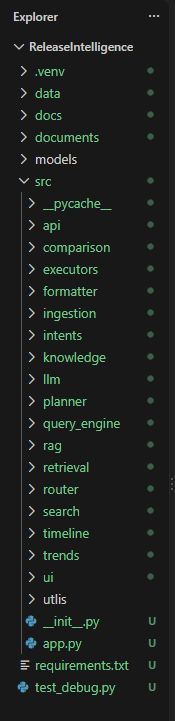
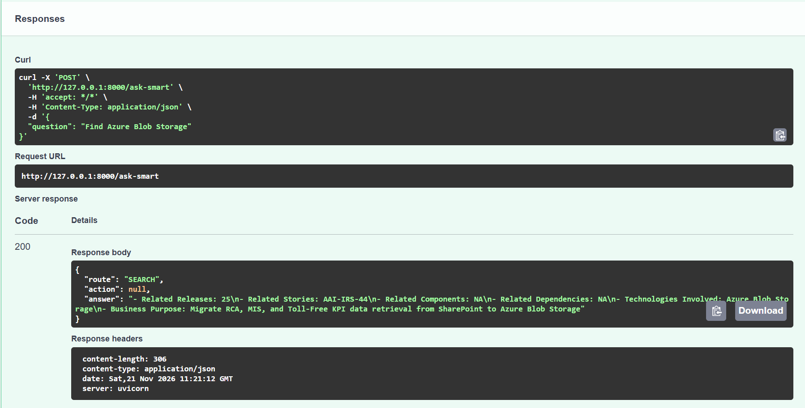
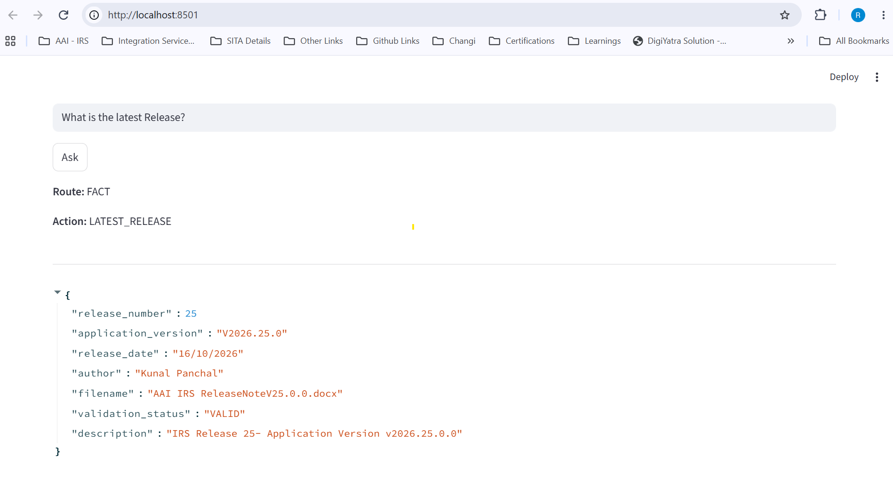

# Screenshots

This directory contains screenshots demonstrating the functionality of the AAI Release Intelligence Assistant.

## Application Preview

## Project Structure



Shows the codebase organization including API, routing, search, trend analysis, knowledge management, and UI modules.

### Swagger UI

The FastAPI Swagger interface used to test and validate the Release Intelligence APIs.


## API Query & Request



Demonstrates a successful query request for the Release Intelligence Assistant to respond. 

## API Query & Response


Demonstrates a successful query execution and API response returned by the Release Intelligence Assistant.

## Streamlit User Interface



Demonstrates the user-facing interface used to submit natural language questions and view Release Intelligence responses.
Open PowerShell in your project folder and run: 
```powershell
python -m streamlit run src\ui\streamlit_app.py
